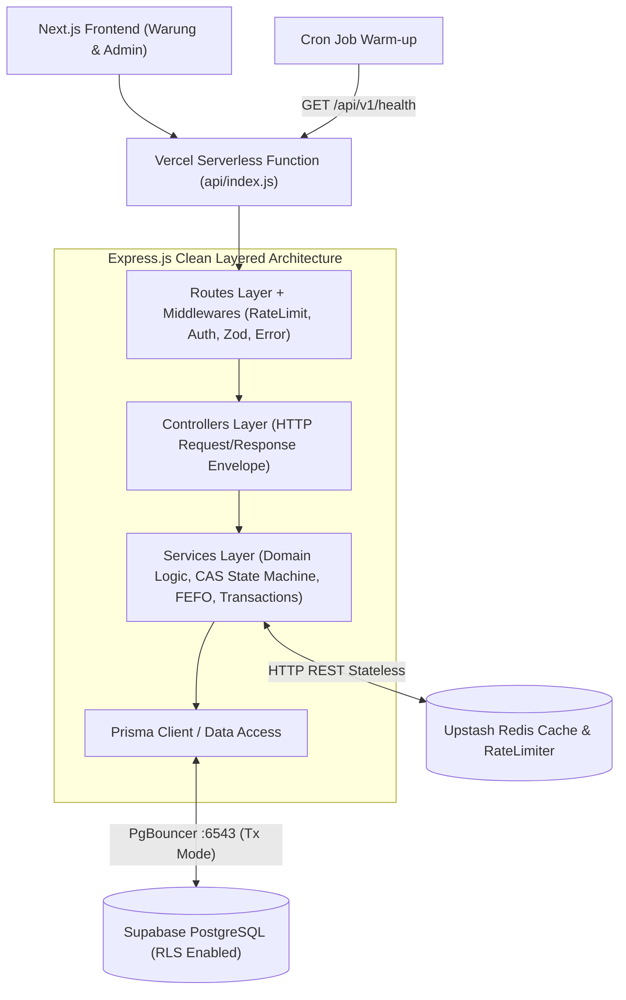

# System Patterns & Architecture Decision Records (ADR)

## 1. High-Level System Architecture

## 2. Clean Layered Architecture Rules
- **Routes (`*.routes.js`):** Hanya menghubungkan endpoint URL, middleware (`rateLimit`, `validate`, `adminAuth`), dan method controller.
- **Controllers (`*.controller.js`):** Menerima `req`, memanggil `service`, dan mengembalikan response melalui helper standar (`sendSuccess`, `sendError`).
- **Schemas (`*.schema.js`):** Validasi ketat terhadap `body`, `query`, dan `params` menggunakan `Zod` (dengan batas koleksi `.max(50)`).
- **Services (`*.service.js`):** Berisi logika bisnis murni, perhitungan FEFO, validasi transisi status order berbasis Compare-And-Swap (CAS), manajemen cache Redis, dan transaksi atomik Prisma (`prisma.$transaction`).

## 3. Architectural Decision Records (ADR)

| ID | Tanggal | Keputusan | Konteks & Alasan | Trade-off |
|----|---------|-----------|------------------|-----------|
| ADR-01 | 2026-10-26 | Gunakan Supabase Transaction Pooler (`:6543?pgbouncer=true&connection_limit=5`) + Direct URL (`:5432`) | Mencegah kehabisan koneksi saat Serverless scale-out sekaligus memberi ruang untuk `Promise.all` di endpoint KPI tanpa antrean panjang. | Prepared statements dinonaktifkan via `pgbouncer=true`; migrasi skema tetap memakai `DIRECT_URL`. |
| ADR-02 | 2026-10-26 | Gunakan `@upstash/redis` berbasis HTTP REST + *Fail-Open Wrapper* + Stateless Rate Limiter | Koneksi TCP Redis tradisional memiliki *overhead* handshake di Serverless. Redis juga dipakai untuk Rate Limiting per IP (`rl:*`). | Sedikit latensi HTTP dibanding TCP persisten, namun jauh lebih stabil di serverless. |
| ADR-03 | 2026-10-26 | Conditional Atomic Stock Decrement & Compare-And-Swap (CAS) Cancel Restock | Mencegah *race condition* ketika dua warung membeli stok terakhir di milidetik yang sama, serta mencegah *double-restock* jika 2 request `CANCELLED` masuk bersamaan. | Membutuhkan pengecekan hasil `updateMany` di dalam `prisma.$transaction`. |
| ADR-04 | 2026-10-26 | SHA-256 Digest + `crypto.timingSafeEqual` Bearer Auth | Menghilangkan kebocoran panjang token (*length side-channel*) sebelum perbandingan *constant-time*. | Satu token untuk operasional admin sesuai spesifikasi PRD. |
| ADR-05 | 2026-10-26 | Enable Supabase RLS & Revoke `anon`/`authenticated` Grants (`prisma/security_rls.sql`) | Menutup akses langsung via Supabase PostgREST Data API jika `anon` key bocor. Prisma tetap berjalan normal sebagai `postgres`. | Klien tidak bisa query tabel langsung dari browser tanpa melewati Backend API. |
| ADR-06 | 2026-10-26 | Verifikasi Toko Wajib sebelum Checkout (`isVerified === true`) & Redaksi PII Tracking | Mencegah bot membuat toko palsu lalu menguras stok, serta menyembunyikan alamat lengkap & menyamarkan nomor HP (`0812****0001`) di endpoint publik `/orders/track/:code`. | Toko baru harus diverifikasi Admin terlebih dahulu sebelum bisa checkout grosir. |
