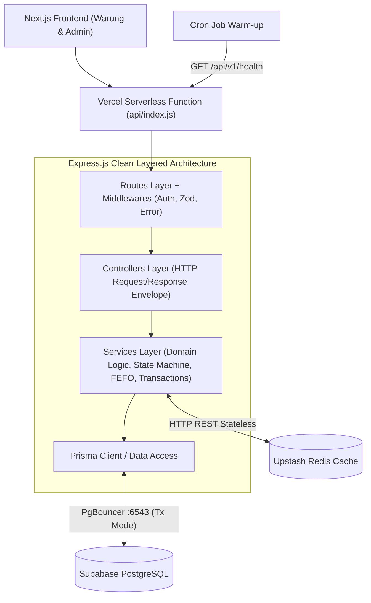

# System Patterns & Architecture Decision Records (ADR)

## 1. High-Level System Architecture

## 2. Clean Layered Architecture Rules
- **Routes (`*.routes.js`):** Hanya menghubungkan endpoint URL, middleware (`validate`, `adminAuth`), dan method controller.
- **Controllers (`*.controller.js`):** Menerima `req`, memanggil `service`, dan mengembalikan response melalui helper standar (`sendSuccess`, `sendError`).
- **Schemas (`*.schema.js`):** Validasi ketat terhadap `body`, `query`, dan `params` menggunakan `Zod`.
- **Services (`*.service.js`):** Berisi logika bisnis murni, perhitungan FEFO, validasi transisi status order, manajemen cache Redis, dan transaksi atomik Prisma (`prisma.$transaction`).

## 3. Architectural Decision Records (ADR)

| ID | Tanggal | Keputusan | Konteks & Alasan | Trade-off |
|----|---------|-----------|------------------|-----------|
| ADR-01 | 2026-10-26 | Gunakan Supabase Transaction Pooler (`:6543?pgbouncer=true&connection_limit=1`) + Direct URL (`:5432`) | Vercel Serverless melakukan *spawn* banyak instance saat trafik naik. Koneksi langsung ke Postgres akan menghabiskan *connection pool*. | Prepared statements dinonaktifkan via `pgbouncer=true`; migrasi skema tetap memakai `DIRECT_URL`. |
| ADR-02 | 2026-10-26 | Gunakan `@upstash/redis` berbasis HTTP REST + *Fail-Open Wrapper* | Koneksi TCP Redis tradisional memiliki *overhead* handshake di Serverless. Wrapper *fail-open* menjamin jika Redis *timeout*, request tetap dilayani dari PostgreSQL. | Sedikit latensi HTTP dibanding TCP persisten, namun jauh lebih stabil di serverless. |
| ADR-03 | 2026-10-26 | Conditional Atomic Stock Decrement & Auto-Restock on Cancel | Mencegah *race condition* ketika dua warung membeli stok terakhir di milidetik yang sama, serta mengembalikan `stockCartons` jika order dibatalkan (`CANCELLED`). | Membutuhkan pengecekan hasil `updateMany` di dalam `prisma.$transaction`. |
| ADR-04 | 2026-10-26 | Constant-Time Bearer Auth (`crypto.timingSafeEqual`) | Mengamankan endpoint `/api/v1/admin/*` dengan `ADMIN_SECRET_KEY` tanpa celah *timing attack*. | Satu token untuk operasional admin sesuai spesifikasi PRD. |

